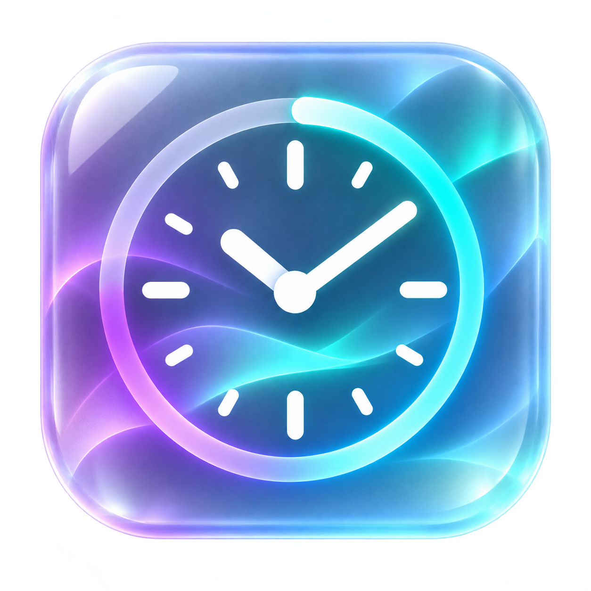

# 玻璃下班时钟



Windows 系统托盘桌面小组件。可从 [Releases](https://github.com/impartOvo/GlassClock/releases) 下载 **GlassClock.exe** 直接运行，也可按下文从源码启动。运行后时钟显示在桌面，程序图标留在右下角系统托盘，不占用任务栏按钮。

## 使用

- 左上角小圆点：每点击一次切换到下一款皮肤，共 10 款。
- 右上角图钉：开启或取消窗口置顶。
- 按住空白处拖动：移动时钟位置。
- 在时钟上右键：直接选择皮肤，开启或关闭雨滴，暂停或恢复动态背景，或者退出。
- 在托盘图标上右键：显示或隐藏时钟、切换皮肤、设置窗口置顶、退出程序；双击托盘图标可重新显示时钟。
- 隐藏或关闭时钟窗口后，程序继续留在系统托盘；需要完全退出时选择“退出时钟”。

雨滴默认开启，可和任意一款皮肤搭配。所有皮肤都有缓慢流动的背景光影；雨滴会在玻璃表面向下滑动。程序会记住位置、皮肤、置顶和动画设置。

中央显示距离下一个 **12:00 或 18:00** 的倒计时；右下角显示距离下一个 18:00 的时间。到达 18:00 后，中央倒计时会切换到次日 12:00。左下角显示北京时间，时间来源于电脑的系统时钟。

## 皮肤

流金琥珀、极光华彩、海蓝波光、午夜纯黑、冰川纯蓝、珍珠纯白、玫瑰香槟、紫晶星辉、翡翠水磨、银灰水晶。

设置保存在可执行文件同级的 `data/settings.json`。程序不需要联网。

## 源码运行

安装 Python 3.13 后，在此文件夹运行 `start.bat`；也可手动执行：

```powershell
python -m venv .venv
.\.venv\Scripts\python.exe -m pip install -r requirements.txt
.\.venv\Scripts\python.exe main.py
```

使用 PyInstaller 构建单文件程序：

```powershell
.\.venv\Scripts\python.exe -m pip install pyinstaller
.\.venv\Scripts\python.exe -m PyInstaller GlassClock.spec
```
